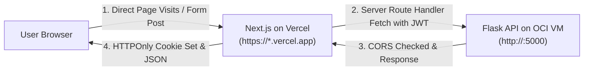

# PRISM Vercel Frontend Deployment Guide (Slice 23)

This guide documents deploying the PRISM Next.js frontend to Vercel and configuring CORS on the OCI VM Flask backend.

---

## 1. Overview & Architecture



- **Frontend Hosting:** Next.js (App Router) on Vercel.
- **Backend API:** Python Flask on OCI Compute VM at port 5000.
- **CORS Protection:** Flask backend verifies incoming `Origin` headers:
  - Allowed: `https://*.vercel.app` and explicitly configured `FRONTEND_URL`.
  - Disallowed: All other origins return **HTTP 403 Forbidden**.
- **Secret Isolation:**
  - `JWT_SECRET`, MySQL, pgvector, Neo4j, Redis, and MinIO credentials live **only** on the OCI VM.
  - Vercel requires **only** `NEXT_PUBLIC_API_URL`.

---

## 2. Deploying to Vercel

### Option A: Via GitHub Integration (Recommended)

1. Push your code to GitHub (or create a pull request / merge to `main`).
2. Log into [vercel.com](https://vercel.com) and click **Add New...** > **Project**.
3. Import the `prism` repository.
4. In the **Configure Project** screen:
   - **Framework Preset:** `Next.js`
   - **Root Directory:** Edit and set to `frontend` (or keep root if utilizing root `vercel.json`).
   - **Build Command:** `npm run build` (default).
   - **Output Directory:** `.next` (default).
5. **Environment Variables:**
   - Name: `NEXT_PUBLIC_API_URL`
   - Value: `http://<OCI_PUBLIC_IP>:5000` (substitute your live OCI VM IP)
6. Click **Deploy**.

### Option B: Via Vercel CLI

```bash
cd frontend
npx vercel login
npx vercel link
npx vercel env add NEXT_PUBLIC_API_URL production
# When prompted, enter: http://<OCI_PUBLIC_IP>:5000
npx vercel --prod
```

---

## 3. Configuring CORS on the OCI Backend

On your OCI VM, update your `.env` file to match your production Vercel URL:
```bash
# In /path/to/prism/.env on the OCI VM:
FRONTEND_URL=https://<your-project>.vercel.app
```

Then reload the containers:
```bash
docker compose up -d
```

The Flask backend will:
1. Allow cross-origin requests from `https://<your-project>.vercel.app` and any `https://*.vercel.app` preview deployment.
2. Return HTTP 403 Forbidden on any other origin (e.g. `https://unauthorized-domain.com`).
3. Allow direct server-to-server requests from Next.js server route handlers (which proxy credentials without sending browser Origin headers).

---

## 4. End-to-End Verification

### Verification 1: Health & CORS Verification

From a terminal:
```bash
# Test allowed Vercel domain:
curl -i -H "Origin: https://my-prism.vercel.app" http://<OCI_PUBLIC_IP>:5000/health
# Response: HTTP/1.1 200 OK
# Access-Control-Allow-Origin: https://my-prism.vercel.app

# Test disallowed domain (must return 403):
curl -i -H "Origin: https://malicious-site.com" http://<OCI_PUBLIC_IP>:5000/health
# Response: HTTP/1.1 403 Forbidden
```

### Verification 2: End-to-End Authentication (`POST /api/auth/login`)

1. Visit your deployed Vercel URL: `https://<your-project>.vercel.app/register`
2. Create an account with name, email, and password.
3. Observe successful registration and login; the browser receives an `httpOnly` cookie (`prism_token`) and redirects to `/dashboard`.
4. Log out and log back in at `/login`.
5. Check Network tab: credentials were sent to Next.js route handler (`/api/auth/login`), forwarded server-side to Flask, and the JWT is stored in an `httpOnly` cookie.

### Verification 3: End-to-End Search (`POST /api/search`)

1. On `/dashboard`, upload a test PDF (e.g. course lecture slides or textbook excerpt) with topics.
2. Navigate to `/search`.
3. Submit a plain-English query (e.g. "relational database normalization").
4. Observe the results:
   - Ranked matching snippets appear.
   - For high similarity scores: cosine distance is shown.
   - If distance > 0.75: MySQL FULLTEXT fallback surfaces with rank.
   - Subsequent identical search displays the **cached** badge from Redis.

---

## 5. Security & Secret Isolation Audit

Acceptance criterion verified:
- **No secrets in frontend bundle:**
  - `JWT_SECRET`, database passwords, Redis/Neo4j credentials are completely absent from client JS bundles and Vercel environment.
  - Only `NEXT_PUBLIC_API_URL` is exposed.
- **httpOnly cookie security:**
  - Client-side JavaScript cannot access the JWT token via `document.cookie`.
  - Next.js server route handlers manage authorization headers to Flask securely.
