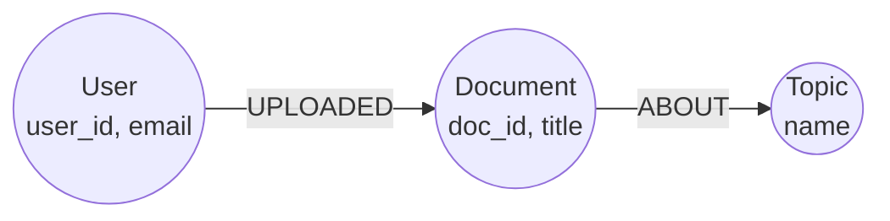
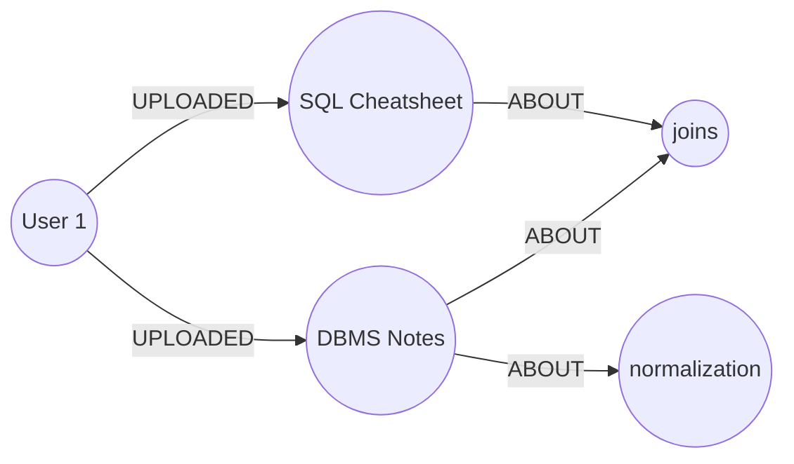
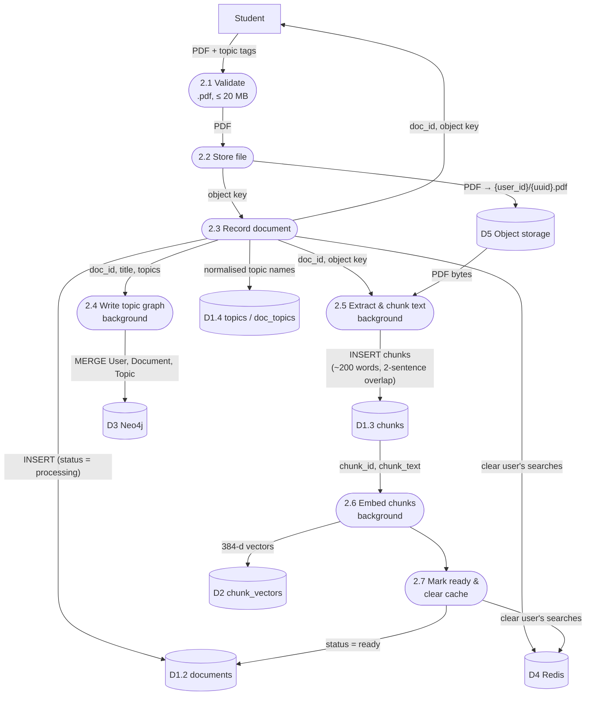
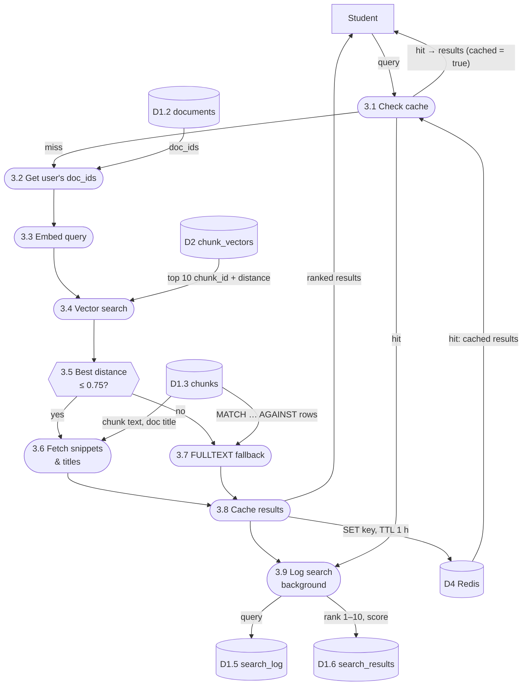
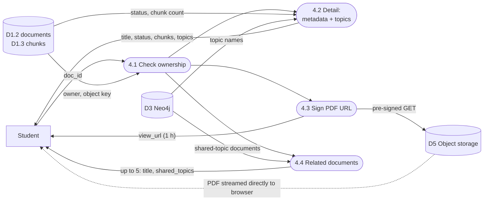
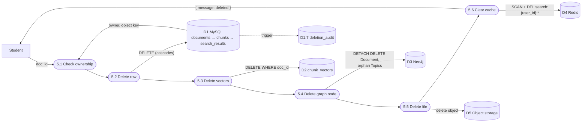
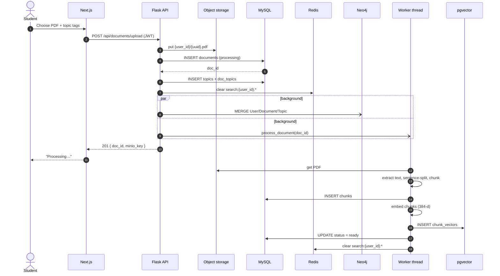
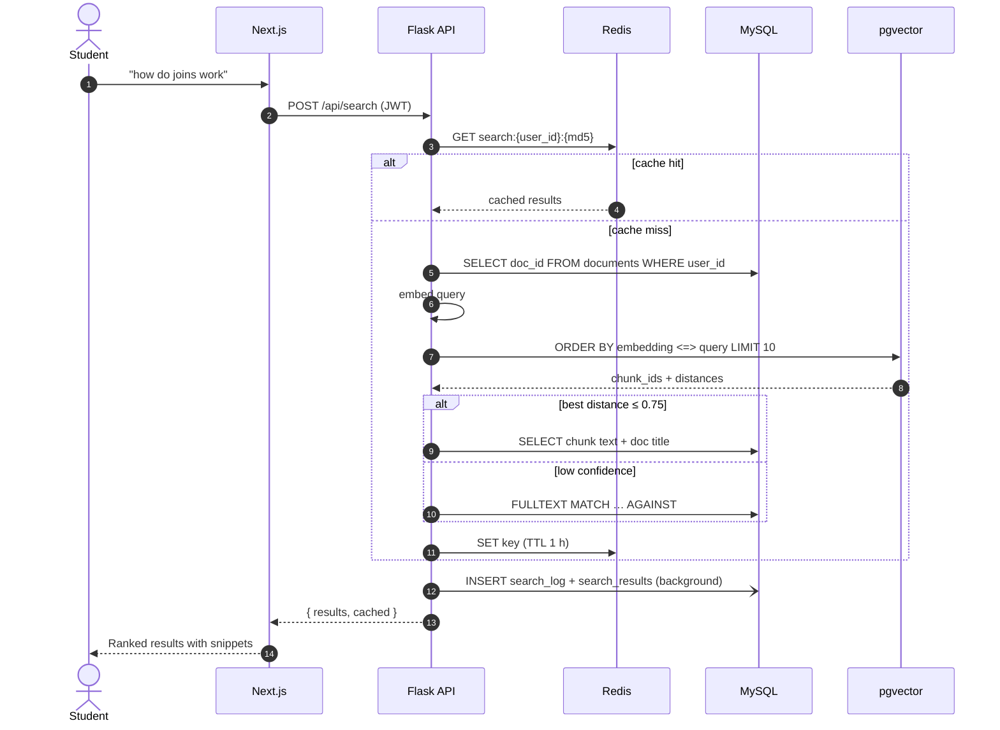

# PRISM — Non-Relational Stores (Vector, Graph, Key-Value, Object)

> Companion document: [relational-schema.md](relational-schema.md) covers the MySQL schema, the Level 0 / Level 1 data flow diagrams, and the authentication and analytics flows.

## 1. Why more than one database

PRISM uses **polyglot persistence**: each kind of data goes to the store that handles it best. MySQL is the source of truth for ownership and text. The four stores below each do one specialised job.

| Store | Engine | Job in PRISM | Hosted on (ADR-015) |
|---|---|---|---|
| Vector | PostgreSQL + **pgvector** | Find chunks whose *meaning* is closest to a query | Neon |
| Graph | **Neo4j** | Find documents that share topics | Neo4j Aura |
| Key-value | **Redis** | Return repeated searches instantly | Upstash |
| Object | **S3-compatible storage** | Keep the original PDF files | Neon Object Storage |

> **A note on pgvector.** It runs inside PostgreSQL, so technically it is SQL. It is grouped here because it acts as a *vector database*, one of the "next-generation" database types, and its job (similarity search over embeddings) is not relational.

### How the stores are linked

The stores share IDs that MySQL generates. No store keeps its own copy of ownership.

| ID | MySQL | pgvector | Neo4j | Redis | Object storage |
|---|---|---|---|---|---|
| `user_id` | `users`, `documents`, `search_log` | — | `User.user_id` | in the key: `search:{user_id}:…` | in the key: `{user_id}/…pdf` |
| `doc_id` | `documents`, `chunks` | `chunk_vectors.doc_id` | `Document.doc_id` | inside the cached value | — |
| `chunk_id` | `chunks` | `chunk_vectors.chunk_id` | — | inside the cached value | — |
| `minio_key` | `documents.minio_key` | — | — | — | the object key |

Every request that names a document first checks in MySQL that the logged-in user owns it, and only then reads the other stores. A maintenance script, `backend/db/reconcile.py`, checks that pgvector, Neo4j and object storage agree with MySQL (see [ADR-016](../decisions/ADR-016-cross-store-delete.md)).

---

## 2. Vector store — PostgreSQL + pgvector

### Schema
```sql
CREATE EXTENSION IF NOT EXISTS vector;

CREATE TABLE chunk_vectors (
    chunk_id  INTEGER PRIMARY KEY,   -- same value as MySQL chunks.chunk_id
    doc_id    INTEGER NOT NULL,      -- copied here so searches can filter by document
    embedding VECTOR(384)            -- all-MiniLM-L6-v2 output
);

CREATE INDEX idx_chunk_vectors_embedding
    ON chunk_vectors USING hnsw (embedding vector_cosine_ops);
```

| Concept | Value |
|---|---|
| Embedding model | `sentence-transformers/all-MiniLM-L6-v2`, runs inside the Flask process |
| Dimensions | 384 |
| Distance | Cosine distance, operator `<=>`. 0 means identical meaning; larger means less similar. |
| Index | **HNSW**, a graph-based approximate nearest-neighbour index. Migration 005 replaced the original ivfflat index because HNSW needs no training data. |
| Confidence threshold | If the best distance is **> 0.75**, search falls back to MySQL FULLTEXT keyword search |

### Similarity query
```sql
SELECT chunk_id, doc_id, (embedding <=> %s::vector) AS score
FROM chunk_vectors
WHERE doc_id = ANY(%s)          -- the user's own doc_ids, fetched from MySQL
ORDER BY score ASC
LIMIT 10;
```

---

## 3. Graph store — Neo4j

### Graph model



| Node | Properties | Identified by |
|---|---|---|
| `User` | `user_id`, `email` | `user_id` |
| `Document` | `doc_id`, `title` | `doc_id` |
| `Topic` | `name`, stored trimmed and lowercase (so "SQL" and "sql" are the same topic) | `name` |

| Relationship | Meaning |
|---|---|
| `(User)-[:UPLOADED]->(Document)` | Who owns the document |
| `(Document)-[:ABOUT]->(Topic)` | Topic tags entered at upload time |

**Example.** Two documents tagged "joins" become connected through one shared `Topic` node:



### Cypher queries

**Write on upload.** `MERGE` means "create only if it doesn't already exist", so repeating the write never creates duplicates.
```cypher
MERGE (u:User {user_id: $user_id}) SET u.email = $email
MERGE (d:Document {doc_id: $doc_id}) SET d.title = $title
MERGE (u)-[:UPLOADED]->(d)
WITH d
UNWIND $topics AS topic_name
MERGE (t:Topic {name: topic_name})
MERGE (d)-[:ABOUT]->(t)
```

**Topics of one document** (document detail page)
```cypher
MATCH (u:User {user_id: $user_id})-[:UPLOADED]->(d:Document {doc_id: $doc_id})-[:ABOUT]->(t:Topic)
RETURN t.name AS name ORDER BY t.name
```

**Related documents.** These are the documents that share the most topics with this one, from the same user only.
```cypher
MATCH (u:User {user_id: $user_id})-[:UPLOADED]->(d1:Document {doc_id: $doc_id})
      -[:ABOUT]->(t:Topic)<-[:ABOUT]-(d2:Document)<-[:UPLOADED]-(u)
WHERE d2.doc_id <> $doc_id
RETURN d2.doc_id AS doc_id, d2.title AS title, COUNT(t) AS shared_topics
ORDER BY shared_topics DESC
LIMIT 5
```
The results are then filtered against MySQL, so only documents that still exist are returned.

**Delete.** Removes the document with its relationships, then any topic no document is about any more.
```cypher
MATCH (:User {user_id: $user_id})-[:UPLOADED]->(d:Document {doc_id: $doc_id})
DETACH DELETE d

MATCH (t:Topic) WHERE NOT (t)<-[:ABOUT]-() DELETE t
```

---

## 4. Key-value cache — Redis

| Aspect | Value |
|---|---|
| Key | `search:{user_id}:{md5(normalized query)}` |
| Normalisation | Lowercase, trim, and collapse repeated spaces, so "Joins  in SQL" and "joins in sql" share one key |
| Value | JSON array of results: `[{ chunk_id, doc_id, doc_title, snippet, score }]` |
| Expiry (TTL) | 3600 s (1 hour) |
| Cleared when | The user uploads a document · a document finishes processing · the user deletes a document |
| How it is cleared | `SCAN` for keys matching `search:{user_id}:*`, then `DEL` (`SCAN` does not block Redis; see ADR-001-redis-cache) |

If Redis cannot be reached, a read counts as a cache miss and a write is skipped. Search still works, just without the speed-up.

Example entry:
```
KEY   search:7:5d41402abc4b2a76b9719d911017c592
TTL   3600
VALUE [{"chunk_id":112,"doc_id":4,"doc_title":"dbms-notes.pdf",
        "snippet":"A join combines rows from two tables…","score":0.31}, …]
```

---

## 5. Object storage — S3-compatible

| Aspect | Value |
|---|---|
| Bucket | `prism-documents` (configurable with `S3_BUCKET`) |
| Object key | `{user_id}/{uuid4}.pdf`, also saved as `documents.minio_key` in MySQL |
| Content type | `application/pdf` |
| Write | When a PDF is uploaded (maximum 20 MB) |
| Read (backend) | The background worker downloads the PDF to extract its text |
| Read (browser) | Through a **pre-signed URL** valid for 1 hour, so the PDF opens in the built-in viewer without being made public |
| Delete | When the document is deleted |

The code uses the standard S3 API (boto3), so the same code runs against MinIO, Neon Object Storage, Cloudflare R2 or AWS S3.

---

## 6. Summary — what each operation touches

| Operation | MySQL | pgvector | Neo4j | Redis | Object storage |
|---|---|---|---|---|---|
| Register / login | read / write | | | | |
| Upload | write | write | write | clear | write |
| Search | read + log | read | | read / write | |
| Document detail | read | | read | | |
| View PDF | read | | | | pre-signed link |
| Related documents | read (ownership + existence) | | read | | |
| Delete | delete (+ audit trigger) | delete | delete | clear | delete |
| Analytics | read | | | | |

---

## 7. Data flow diagrams

**Notation:** rectangle = external entity · rounded box = process · cylinder = data store · arrow = data flow. These are Level 2 breakdowns of the Level 1 processes in [relational-schema.md § 7](relational-schema.md#7-data-flow-diagrams).

### Level 2 — 2.0 Upload & process document



The user gets a response right after step 2.3. Steps 2.4 to 2.7 run in background threads, and the dashboard shows the document as `processing` until step 2.7 completes. If text extraction or embedding fails, the status is set to `error`.

### Level 2 — 3.0 Search



Every search is logged (step 3.9), including cache hits, so the analytics reflect what users actually asked.

### Level 2 — 4.0 View document



### Level 2 — 5.0 Delete document



### Sequence — Upload



### Sequence — Search


