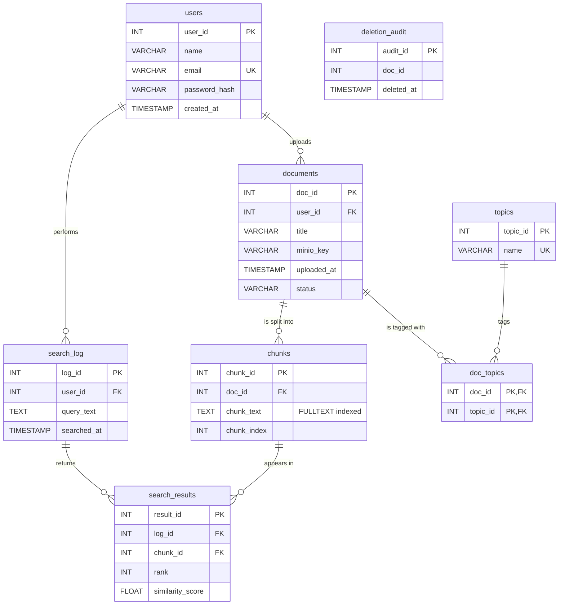
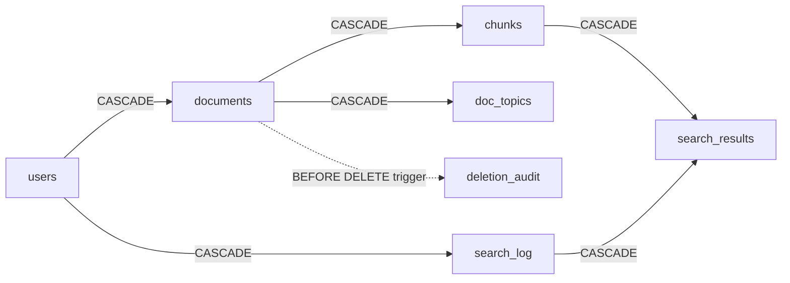
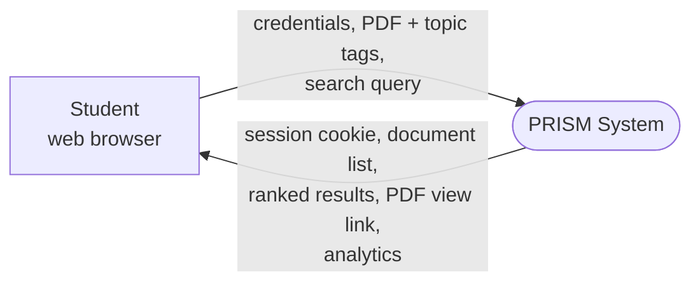
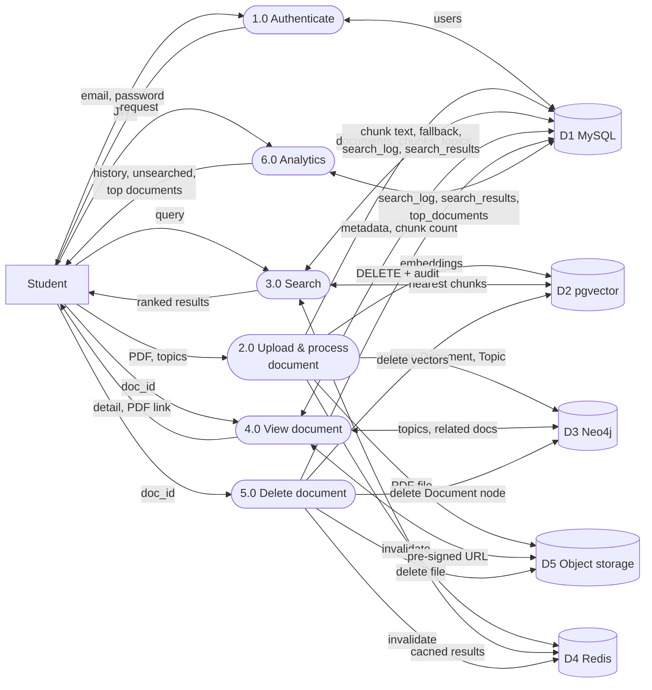
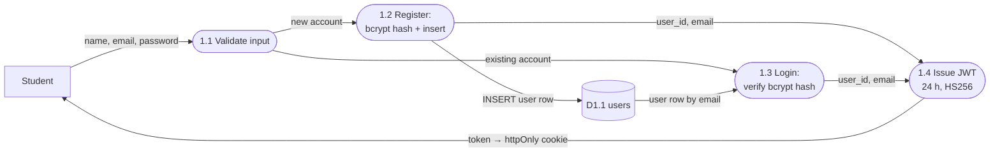
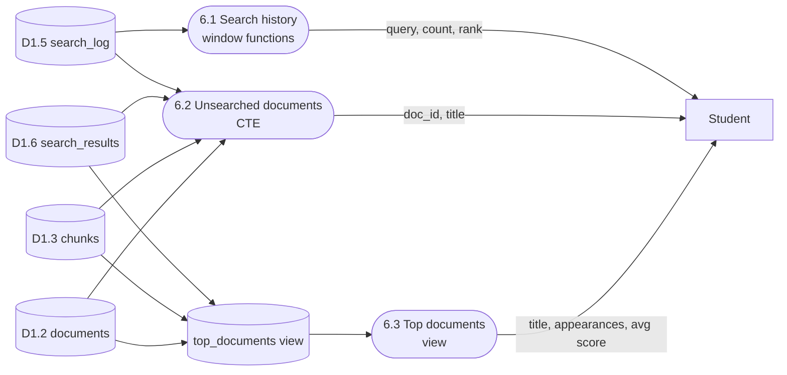

# PRISM — Relational Schema (MySQL)

> Companion document: [nosql-schema.md](nosql-schema.md) covers pgvector, Neo4j, Redis and object storage.

## 1. Where MySQL fits

PRISM stores each kind of data in the database best suited to it. **MySQL is the source of truth**: it owns users, documents, text chunks and the search history. Every other store refers back to IDs that MySQL generates.

| Store | Engine | What it holds | Document |
|---|---|---|---|
| **Relational** | **MySQL 8** | **Users, documents, chunks, search logs, audit** | **this file** |
| Vector | PostgreSQL + pgvector | One 384-number embedding per chunk | [nosql-schema.md](nosql-schema.md#2-vector-store--postgresql--pgvector) |
| Graph | Neo4j | User → Document → Topic links | [nosql-schema.md](nosql-schema.md#3-graph-store--neo4j) |
| Key-value | Redis | Cached search results | [nosql-schema.md](nosql-schema.md#4-key-value-cache--redis) |
| Object | S3-compatible storage | The original PDF files | [nosql-schema.md](nosql-schema.md#5-object-storage--s3-compatible) |

All SQL is raw (no ORM) and lives in `backend/modules/*/db.py`. The schema is created by numbered scripts in `backend/db/migrations/`, applied in order by `backend/db/migrate.py`.

---

## 2. Entity–Relationship diagram



**Reading the diagram**

- A **user** uploads many **documents** and runs many **searches**.
- A **document** is split into many **chunks** (paragraph-sized pieces of text, about 200 words each).
- **Documents** and **topics** are many-to-many, resolved through the junction table **doc_topics**.
- Each **search** (`search_log`) records up to 10 **results**, and each result points to the **chunk** that matched.
- **deletion_audit** deliberately has no foreign key: it keeps a record of documents that no longer exist.

---

## 3. Tables

### `users`
Registered accounts.

| Column | Type | Notes |
|---|---|---|
| `user_id` | INT, auto-increment | Primary key |
| `name` | VARCHAR(255) | Required |
| `email` | VARCHAR(255) | Required, **UNIQUE**, stored lowercase |
| `password_hash` | VARCHAR(255) | bcrypt hash (the plain password is never stored) |
| `created_at` | TIMESTAMP | Defaults to the current time |

### `documents`
One row per uploaded PDF.

| Column | Type | Notes |
|---|---|---|
| `doc_id` | INT, auto-increment | Primary key |
| `user_id` | INT | FK → `users`, `ON DELETE CASCADE` |
| `title` | VARCHAR(255) | Sanitised file name |
| `minio_key` | VARCHAR(255) | Where the PDF lives in object storage: `{user_id}/{uuid}.pdf` |
| `uploaded_at` | TIMESTAMP | Defaults to the current time |
| `status` | VARCHAR(50) | `processing` (default) → `ready` or `error` |

### `chunks`
The searchable text of a document, split into overlapping pieces.

| Column | Type | Notes |
|---|---|---|
| `chunk_id` | INT, auto-increment | Primary key. The same ID is used in pgvector. |
| `doc_id` | INT | FK → `documents`, `ON DELETE CASCADE` |
| `chunk_text` | TEXT | **FULLTEXT index** for keyword search |
| `chunk_index` | INT | Position of the chunk within the document (0, 1, 2 …) |

### `topics` and `doc_topics`
The relational (many-to-many) form of topic tagging.

| Table | Column | Type | Notes |
|---|---|---|---|
| `topics` | `topic_id` | INT, auto-increment | Primary key |
| `topics` | `name` | VARCHAR(255) | **UNIQUE** |
| `doc_topics` | `doc_id` | INT | Part of the composite PK; FK → `documents`, `ON DELETE CASCADE` |
| `doc_topics` | `topic_id` | INT | Part of the composite PK; FK → `topics`, `ON DELETE CASCADE` |

Topic tags are written here and to the Neo4j graph at upload time, using the same trimmed, lowercase names. MySQL holds the relational model; Neo4j answers the topic and related-document queries (see [nosql-schema.md](nosql-schema.md#3-graph-store--neo4j)).

### `search_log`
One row per search a user runs.

| Column | Type | Notes |
|---|---|---|
| `log_id` | INT, auto-increment | Primary key |
| `user_id` | INT | FK → `users`, `ON DELETE CASCADE` |
| `query_text` | TEXT | The search exactly as the user typed it, trimmed |
| `searched_at` | TIMESTAMP | Defaults to the current time |

### `search_results`
The ranked results returned for each search.

| Column | Type | Notes |
|---|---|---|
| `result_id` | INT, auto-increment | Primary key |
| `log_id` | INT | FK → `search_log`, `ON DELETE CASCADE` |
| `chunk_id` | INT | FK → `chunks`, `ON DELETE CASCADE` |
| `rank` | INT | 1 to 10 |
| `similarity_score` | FLOAT, nullable | Cosine distance from vector search (lower is closer); the app shows it as similarity, 1 − distance. `NULL` when the keyword (FULLTEXT) fallback produced the result. |

### `deletion_audit`
Audit trail written by a trigger whenever a document is deleted.

| Column | Type | Notes |
|---|---|---|
| `audit_id` | INT, auto-increment | Primary key |
| `doc_id` | INT | ID of the deleted document (no FK, because the row is gone) |
| `deleted_at` | TIMESTAMP | When the deletion happened |

### `schema_migrations` (bookkeeping)
`migration_name` (PK) and `applied_at`. The migration runner records each script here so it is applied only once. The same table exists in PostgreSQL.

---

## 4. Constraints, cascades, view, trigger, indexes

### Cascade chain
Deleting a user or a document cleans up everything that depends on it:



### Trigger — `before_document_delete`
```sql
CREATE TRIGGER before_document_delete
BEFORE DELETE ON documents
FOR EACH ROW
BEGIN
    INSERT INTO deletion_audit (doc_id, deleted_at) VALUES (OLD.doc_id, NOW());
END;
```

### View — `top_documents`
Ranks documents by how many searches they came up in. `search_count` counts each search once; `appearance_count` counts the document's passages across those searches (up to 10 per search). The totals are computed when the view is queried, not stored.
```sql
CREATE OR REPLACE VIEW top_documents AS
SELECT d.user_id, d.doc_id, d.title,
       COUNT(sr.result_id)       AS appearance_count,
       AVG(sr.similarity_score)  AS avg_score,
       COUNT(DISTINCT sr.log_id) AS search_count
FROM search_results sr
JOIN chunks c    ON sr.chunk_id = c.chunk_id
JOIN documents d ON c.doc_id    = d.doc_id
GROUP BY d.doc_id, d.user_id, d.title;
```

### Indexes
| Index | On | Why |
|---|---|---|
| Primary keys and `UNIQUE(email)`, `UNIQUE(topics.name)` | — | Identity and uniqueness |
| `ft_chunk_text` (FULLTEXT) | `chunks(chunk_text)` | Keyword-search fallback (`MATCH … AGAINST`) |
| `idx_search_log_user_time` | `search_log(user_id, searched_at)` | Search-history analytics for one user |
| `idx_search_results_log_id` | `search_results(log_id)` | Join chain in the analytics queries |
| `idx_search_results_chunk_id` | `search_results(chunk_id)` | Join chain in the analytics queries |

The before/after `EXPLAIN` results for these indexes are in [ADR-001-indexing.md](../decisions/ADR-001-indexing.md).

---

## 5. Normalization

| Normal form | How the schema meets it |
|---|---|
| **1NF** | Every column holds one atomic value. Document text is stored as rows in `chunks`, not as one large blob. Topics are rows in `doc_topics`, not a comma-separated list. |
| **2NF** | The only composite key, `doc_topics(doc_id, topic_id)`, has no other columns, so there are no partial dependencies. |
| **3NF** | No transitive dependencies. For example, `search_results` stores `chunk_id` but not `doc_id` or `title`, which are reached through `chunks → documents`. Aggregates such as `appearance_count` are computed by the `top_documents` view instead of being stored. |
| **BCNF** | Every determinant is a candidate key. In `users`, both `user_id` and `email` are candidate keys. |

---

## 6. Key queries

These are the main SQL statements the backend runs. Every one is parameterised and scoped to the logged-in user.

**Login lookup** (auth)
```sql
SELECT user_id, name, email, password_hash, created_at FROM users WHERE email = %s;
```

**Document list with chunk counts** (documents, LEFT JOIN + GROUP BY)
```sql
SELECT d.doc_id, d.title, d.uploaded_at, d.status, COUNT(c.chunk_id) AS chunk_count
FROM documents d
LEFT JOIN chunks c ON d.doc_id = c.doc_id
WHERE d.user_id = %s
GROUP BY d.doc_id, d.title, d.uploaded_at, d.status
ORDER BY d.uploaded_at DESC;
```

**Keyword fallback search** (search, FULLTEXT). Used when vector search is not confident enough.
```sql
SELECT c.chunk_id, c.doc_id, d.title AS doc_title, c.chunk_text AS snippet
FROM chunks c
JOIN documents d ON c.doc_id = d.doc_id
WHERE d.user_id = %s
  AND MATCH(c.chunk_text) AGAINST(%s IN NATURAL LANGUAGE MODE)
LIMIT %s;
```

**Search history** (analytics, window functions)
```sql
SELECT query_text,
       COUNT(*)                             AS search_count,
       RANK() OVER (ORDER BY COUNT(*) DESC) AS query_rank,
       MAX(searched_at)                     AS last_searched,
       SUM(COUNT(*)) OVER ()                AS total_searches
FROM search_log
WHERE user_id = %s
GROUP BY query_text
ORDER BY query_rank;
```

**Never-searched documents** (analytics, CTE)
```sql
WITH searched_docs AS (
    SELECT DISTINCT d.doc_id
    FROM search_results sr
    JOIN chunks c      ON sr.chunk_id = c.chunk_id
    JOIN documents d   ON c.doc_id    = d.doc_id
    JOIN search_log sl ON sr.log_id   = sl.log_id
    WHERE sl.user_id = %s
)
SELECT doc_id, title, uploaded_at
FROM documents
WHERE user_id = %s
  AND status = 'ready'
  AND doc_id NOT IN (SELECT doc_id FROM searched_docs);
```

**Top documents** (analytics, view)
```sql
SELECT doc_id, title, search_count, appearance_count, avg_score
FROM top_documents
WHERE user_id = %s
ORDER BY search_count DESC, appearance_count DESC
LIMIT 10;
```

---

## 7. Data flow diagrams

**Notation:** rectangle = external entity · rounded box = process · cylinder = data store · arrow = data flow.

### Level 0 — Context diagram



### Level 1 — System processes

The browser talks to the Next.js frontend. The frontend keeps the login token (JWT) in an httpOnly cookie and forwards each request to the Flask API.



Processes 2.0 to 5.0 are broken down in [nosql-schema.md § 7](nosql-schema.md#7-data-flow-diagrams), because they span several stores. The two processes below use MySQL only.

### Level 2 — 1.0 Authenticate



### Level 2 — 6.0 Analytics (read-only)


